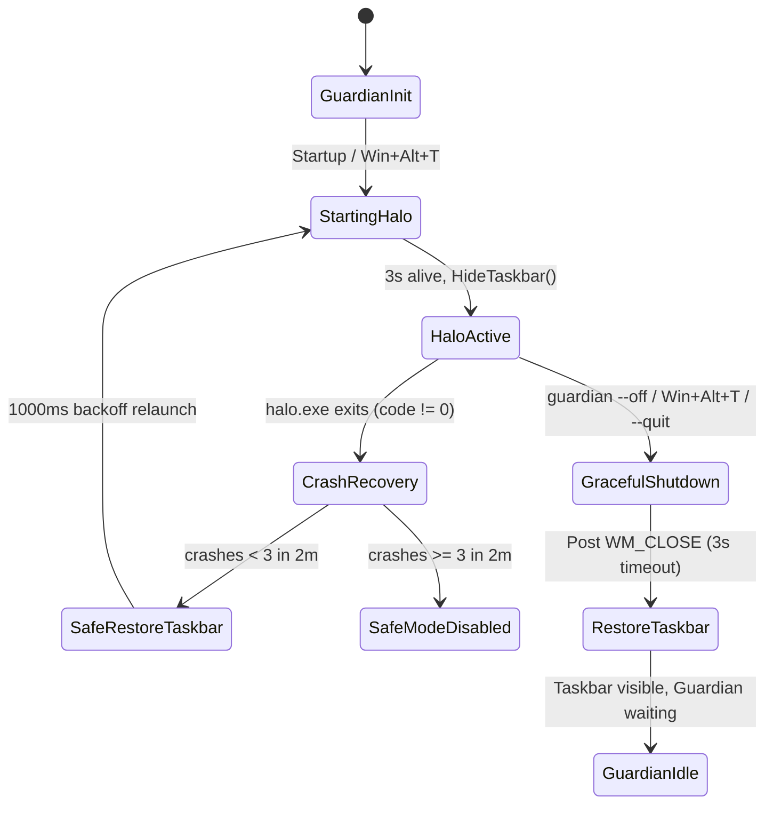
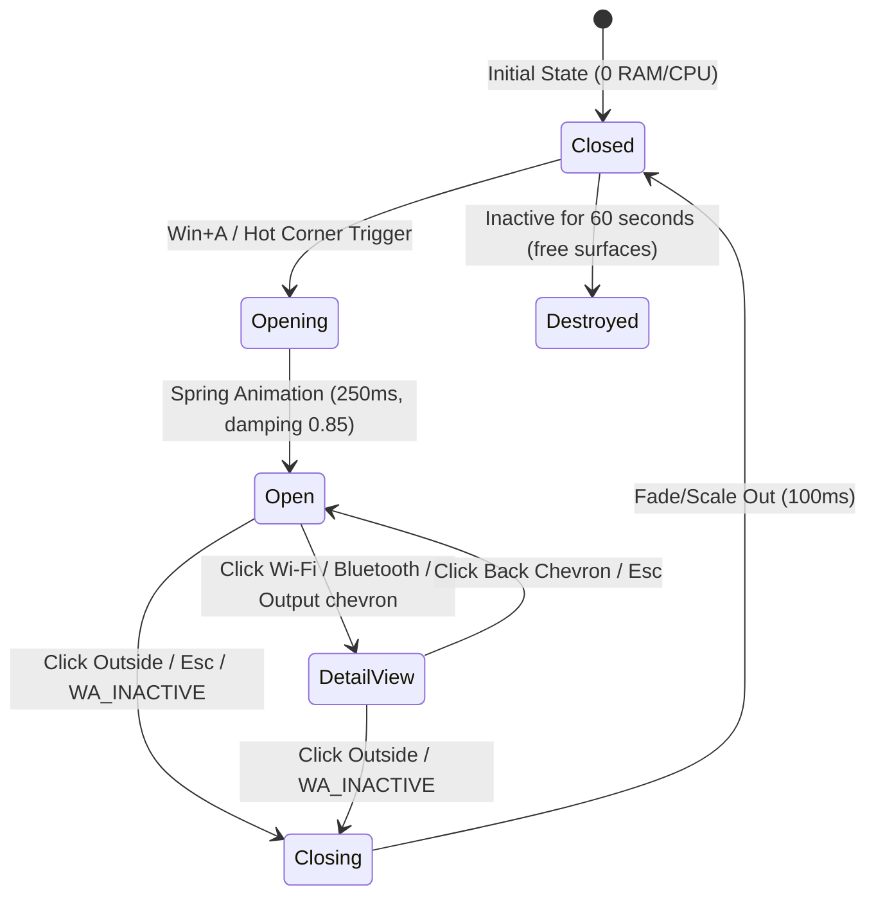
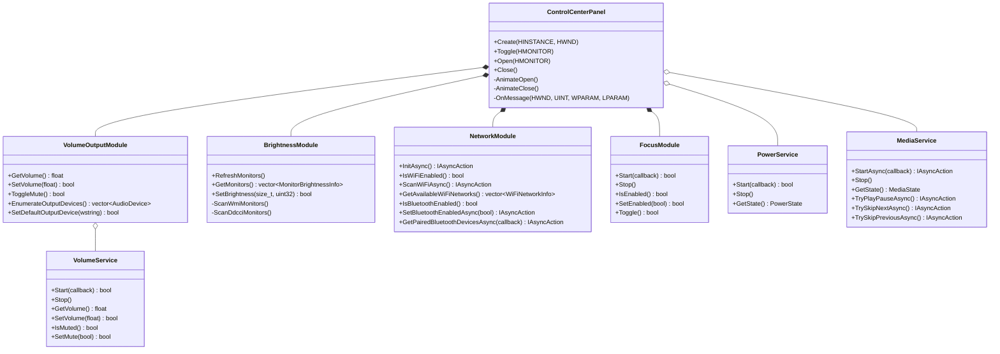

> **Status (implemented, supersedes sections 2-8 where they differ).** Code: `src/control_center.{h,cpp}` (panel, drawing,
> hot zone), `src/services.{h,cpp}` (audio, power, brightness, radios, DND, Now Playing), hook in `src/winkey.cpp`.
> Differences from this spec: services bind on open and unbind on close (no listener while closed), foreign-thread
> callbacks only `PostMessage`; the window and every composition/DirectWrite object are destroyed on close (no 60 s
> timer); DND is the `NOC_GLOBAL_SETTING_TOASTS_ENABLED` registry value (the `IQuietHoursSettings` vtable was
> unverifiable); brightness is WMI only (no DDC/CI), instances found by `__PATH`; Wi-Fi/Bluetooth are `Radio` toggles
> (no network list yet); the hot zone is a 2 px strip on the right edge just below the caption-button row, so it never
> covers a maximized window's close button. Test with `tools/cc-shots.ps1` (dry-run: `HALO_TEST_CC_DRYRUN=1`).

# Halo Control Center MVP: Architecture & Implementation Specification

*Document version: 1.0 (Task 4 MVP)*  
*Target Environment: Windows 11 Build 26300+, LLVM-MinGW Clang (C++23), Windows.UI.Composition*

---

## 1. Executive Summary & Design Context

In the Halo desktop shell, the bottom dock replaces the traditional Windows taskbar (`Shell_TrayWnd`), hiding the system tray, notification center, and Quick Settings flyout. 

Per the design decisions recorded in [`docs/DESIGN.md`](../docs/DESIGN.md) (which supersedes the top menu-bar proposal in [`docs/CONTROL-CENTER.md`](../docs/CONTROL-CENTER.md)):
1. **No permanent top menu bar:** Screen real estate is preserved at 100% full height for applications.
2. **Dock Status Cluster:** Passive status indicators (clock, Wi-Fi connection glyph, battery percentage + icon, Start button) reside on the left flank of the dock pill.
3. **Floating Control Center:** All active controls and toggles live inside an on-demand, floating frosted-glass panel in the top-right corner of the screen.
4. **Trigger Mechanisms:**
   - Global keyboard shortcut: **`Win+A`** (intercepted from Windows Quick Settings while Halo is active).
   - Mouse gesture: **Top-right screen edge / hot corner** with dwell detection (mirroring the bottom edge reveal of the dock).
5. **Zero Idle CPU Requirement:** No continuous polling loops (0 ms CPU over 60 seconds idle). Every state change is driven by OS event sinks, callbacks, or on-demand reads when the panel is opened.

---

## 2. Process Architecture & State Machines

Halo employs a two-tier process model:
- **`guardian.exe`**: Tiny, watchdog process without UI. Exclusively owns taskbar hiding and guarantees taskbar restoration if `halo.exe` exits or crashes.
- **`halo.exe`**: Single-threaded STA UI host process containing the dock surface, status cluster, low-level hooks, background services, and on-demand Control Center panel.

### 2.1 State Machine: `guardian.exe` and `halo.exe` Lifecycle



| Event / Transition | Guardian Action | Halo Action | IPC Mechanism |
|---|---|---|---|
| **Startup / Switch ON** | Launches `halo.exe`; arms 3s hide timer | Initializes DispatcherQueue, Compositor, Dock, Hooks | `CreateProcessW` |
| **Hide Taskbar** | Calls `SafeHide()` on `Shell_TrayWnd` | Dock springs up; hit regions active | Internal guardian timer |
| **Normal Close / Switch OFF** | Sends `WM_CLOSE` to `HaloDockWindow`; waits up to 3s | Closes Control Center; unregisters hooks; exits 0 | `PostMessageW(WM_CLOSE)` |
| **Crash Loop Guard** | Catches process death; immediately calls `SafeRestore()` | Process terminated | `MsgWaitForMultipleObjects` |
| **Taskbar Recreated** | Catches `TaskbarCreated` broadcast; re-hides | Refreshes dock icons | Registered Window Message |

---

### 2.2 Internal State Machine: Control Center Panel



- **`Closed`**: Window hidden (`SW_HIDE`) or destroyed. Zero GPU composition cost, zero CPU usage. Background listeners continue to receive push notifications.
- **`Opening`**: Window positioned at `{rcMonitor.right - 348, rcMonitor.top + 12}`; size 336x440. WMI/DDC-CI brightness refreshed once. `Compositor` spring animation triggers:
  - Opacity: $0.0 \to 1.0$ (120 ms).
  - Scale: $0.96 \to 1.0$ (spring damping 0.85, response 0.25 s).
  - Translation Y: $-6\text{ px} \to 0\text{ px}$.
- **`Open`**: Main 4-column module grid active. Receives mouse and keyboard focus.
- **`DetailView`**: Sub-page slides in ($+12\text{ px}$ from right, 160 ms fade). Shows detailed network list, Bluetooth devices, or audio endpoints.
- **`Closing`**: 100 ms ease-in fade to opacity 0, scale to 0.98. Window hidden.
- **`Teardown Timer`**: If closed for $> 60\text{ s}$, the Win32 HWND and composition targets are released, reclaiming $\sim 20\text{ MB}$ working set.

---

## 3. Hotkey Handling & Hot Corner Detection

### 3.1 Taking Over `Win+A`

On standard Windows 11, `Win+A` invokes the Quick Settings flyout via `ShellExperienceHost.exe`. Windows' shell registers this hotkey during shell initialization. Calling `RegisterHotKey(hwnd, ID, MOD_WIN, 'A')` returns error `1409` (`ERROR_HOTKEY_ALREADY_REGISTERED`).

To intercept `Win+A` cleanly while Halo is running:

1. **Dedicated Hook Thread:**
   Halo runs a low-level keyboard hook (`WH_KEYBOARD_LL`) on its own thread (see [`src/winkey.cpp`](../src/winkey.cpp)), isolating hook execution from any UI thread stalls.
2. **Interception & Suppression Logic:**
   - The hook tracks whether `VK_LWIN` or `VK_RWIN` is currently held (`winDown == true`).
   - When a key event arrives with `vkCode == 'A'` (or `0x41`) while `winDown` is true:
     - The hook **swallows the key press** (returns `1` immediately).
     - It injects an unassigned dummy key (`kUnassigned = 0xE8`) via `SendInput` with `dwExtraInfo = 0x48414C4F` ("HALO"). This breaks the "lone Win key tap" sequence so the Windows Start Menu is not accidentally triggered upon releasing the Windows key.
     - It posts `kMsgToggleControlCenter` (`WM_APP + 10`) to Halo's main message window.
   - Any other `Win+<key>` combinations (`Win+E`, `Win+R`, `Win+L`, `Win+V`) pass through untouched to the OS.
3. **Restoration:**
   When Halo exits or the user toggles Halo off via `Win+Alt+T`, the hook is uninstalled (`UnhookWindowsHookEx`), instantly restoring default Windows `Win+A` behavior.

### 3.2 Top-Right Hot Corner Detection

To open Control Center with a mouse flick without colliding with maximized window caption buttons (Minimize, Maximize, Close `[X]`):

```
+-------------------------------------------------------------+-----+
| Maximized Window Titlebar                      [_]  [#]  [X]| HOT | <- 2px hit strip
+-------------------------------------------------------------+-----+
                                                              |     |
                                                              | CC  |
                                                              |     |
```

1. **Geometry & Placement:**
   - Caption buttons on Windows 11 occupy the top right: Close `[X]` is 46 px wide and 30 px tall.
   - Halo creates a dedicated transparent hit-strip window (`HaloHotCornerHitStrip`) measuring **64 px wide by 2 px tall** along the extreme upper-right boundary:
     $$\text{Rect} = \{ x: \text{rcMonitor.right} - 64,\; y: \text{rcMonitor.top},\; w: 64,\; h: 2 \}$$
   - Window style: `WS_POPUP | WS_EX_TOOLWINDOW | WS_EX_TOPMOST | WS_EX_NOACTIVATE`.
2. **Dwell Filtering (150 ms):**
   - When the user aims for the `[X]` button, the cursor decelerates and stays inside the $30\text{ px}$ tall button band without slamming into the top 2 px edge.
   - When the cursor enters the 2 px edge, `WM_MOUSEMOVE` arms a one-shot 150 ms timer (`SetTimer(hwnd, 1, 150, nullptr)`) and calls `TrackMouseEvent(TME_LEAVE)`.
   - If the cursor leaves before 150 ms, `WM_MOUSELEAVE` kills the timer.
   - If the cursor rests in the corner for 150 ms, the timer fires and posts `kMsgHotCornerTrigger` (`WM_APP + 12`), smoothly revealing the Control Center.
   - **CPU Cost:** 0% when the cursor is elsewhere.

---

## 4. Class Structure & C++/WinRT Architecture

The Control Center subsystem is structured into two layers:
1. **`src/services.h`**: Lightweight, thread-safe, non-UI service listeners (Core Audio, Power, GSMTC).
2. **`src/control_center.h`**: Interactive module controllers, undocumented COM routers, WMI/DDC-CI adapters, and the composition UI container.



---

## 5. Module Technical Implementations

### 5.1 Volume & Output Device Module
- **Volume & Mute:**
  - Backed by `IAudioEndpointVolume` on default `eRender` / `eMultimedia` endpoint.
  - Changes pushed via `IAudioEndpointVolumeCallback::OnNotify`.
  - Default device changes tracked via `IMMNotificationClient::OnDefaultDeviceChanged`.
- **Output Device Switching:**
  - Enumerates active render endpoints via `IMMDeviceEnumerator::EnumAudioEndpoints(eRender, DEVICE_STATE_ACTIVE)`.
  - Device friendly names resolved via `IPropertyStore::GetValue(PKEY_Device_FriendlyName)`.
  - Switching invokes the undocumented `IPolicyConfig::SetDefaultEndpoint`:
    - CLSID: `{870af99c-171d-4f9e-af0d-e63df40c2bc9}`
    - IID: `{f8679f50-850a-41cf-9c72-430f290290c8}`
    - Updates `eConsole`, `eMultimedia`, and `eCommunications` roles.
  - Fallback: If COM creation fails, invokes `ShellExecuteW(nullptr, L"open", L"ms-settings:sound", ...)`.

### 5.2 Display Brightness Module
- **Internal Laptop Panels:**
  - WMI namespace: `root\wmi`.
  - Reading: Query `SELECT * FROM WmiMonitorBrightness` -> `CurrentBrightness`.
  - Setting: Invoke method `WmiSetBrightness` on `WmiMonitorBrightnessMethods` with a 1-second timeout.
- **External Desktop Monitors (DDC/CI):**
  - Uses `dxva2.dll`: `EnumDisplayMonitors` $\to$ `GetPhysicalMonitorsFromHMONITOR`.
  - Read brightness: `GetMonitorBrightness(hPhysicalMonitor, &min, &cur, &max)`.
  - Set brightness: `SetMonitorBrightness(hPhysicalMonitor, level)`.
  - **Zero Polling & Coalesced Writes:** DDC/CI round-trips over I2C take $\sim 50\text{ ms}$. Brightness is read once when the panel opens or on `WM_DISPLAYCHANGE`. During slider dragging, writes are throttled to 50 ms intervals.

### 5.3 Wi-Fi & Bluetooth Module
- **Wi-Fi:**
  - C++/WinRT `winrt::Windows::Devices::WiFi::WiFiAdapter`.
  - `FindAllAdaptersAsync()` finds physical adapters.
  - `AvailableNetworksChanged` provides push updates when network topology changes.
  - `ScanAsync()` triggers an active 802.11 beacon scan when opening the Wi-Fi detail view.
- **Bluetooth:**
  - C++/WinRT `winrt::Windows::Devices::Radios::Radio::GetRadiosAsync()`.
  - Filters by `RadioKind::Bluetooth`.
  - State toggle: `radio.SetStateAsync(RadioState::On / RadioState::Off)`.
  - Paired device discovery: `DeviceInformation::FindAllAsync(BluetoothDevice::GetDeviceSelectorFromPairingState(true))`.

### 5.4 Focus / Do Not Disturb Module
- **State Reading:**
  - `ToastNotificationManagerForUser.NotificationMode()`: returns `Unrestricted` (Off), `PriorityOnly` (On), or `AlarmsOnly`.
  - Event listener: `NotificationModeChanged` notifies of mode toggles made from settings or schedule.
- **State Setting:**
  - Undocumented `IQuietHoursSettings` interface:
    - CLSID: `{f53321fa-34f8-4b7f-b9a3-361877cb94cf}`
    - IID: `{6bff4732-81ec-4ffb-ae67-b6c1bc29631f}`
    - Method: `put_UserSelectedProfile(L"Microsoft.QuietHoursProfile.PriorityOnly" / L"Microsoft.QuietHoursProfile.Unrestricted")`.
  - Fallback: ShellExecute `ms-settings:notifications`.

### 5.5 Media / Now Playing Module
- Backed by C++/WinRT `GlobalSystemMediaTransportControlsSessionManager`.
- Subscribes to:
  - `CurrentSessionChanged`: Active media player switch (Spotify, Chrome, Edge, Apple Music).
  - `PlaybackInfoChanged`: Play/pause state changes.
  - `MediaPropertiesChanged`: Track title, artist, album, and thumbnail updates.
- Playback controls: `TryPlayAsync()`, `TryPauseAsync()`, `TrySkipNextAsync()`, `TrySkipPreviousAsync()`.

### 5.6 Battery & Power Module
- Baseline reading: `GetSystemPowerStatus` (`ACLineStatus`, `BatteryFlag`, `BatteryLifePercent`).
- Event notifications: `PowerSettingRegisterNotification` with `DEVICE_NOTIFY_CALLBACK`:
  - `kGuidBatteryPercentageRemaining` (`{a7ad8041-b45a-4cae-87a3-eecbb468a9e1}`)
  - `kGuidAcDcPowerSource` (`{5d3e9a59-e9d5-4b00-a6bd-ff34ff516548}`)
- Power Mode notifications: `PowerRegisterForEffectivePowerModeNotifications` (`EFFECTIVE_POWER_MODE_V2`) in `powrprof.dll`.

---

## 6. Visual Layout & Motion Specifications

All visual styling adheres to Quiet Dock & Halo specifications:

| Token | Dimension / Value | Description |
|---|---|---|
| **Width** | 336 logical px | Compact panel width |
| **Height** | Auto (~440 px collapsed) | Fits within 1080p and 1200p work areas |
| **Corner Radius** | 20 px (panel), 10 px (tiles), 18 px (sliders) | Concentric optical radii |
| **Glass Material** | Gaussian blur 40, tint `#16161A` @ 50%, 2.5% grain | Matched to bottom dock pill |
| **Grid** | 12 px outer padding, 12 px gap, 4 cols (69 px col, 150 px wide) | Standard macOS modular grid |
| **Sliders** | 36 px tall pill, inline glyph, 1:1 drag | Sound and Display brightness |
| **Spring Motion** | Damping ratio 0.85, period 250 ms | `CreateSpringScalarAnimation` on Offset / Scale |

```
+-------------------------------------------------------+
|  [ Wi-Fi (SSID)       >]   [ Bluetooth (On)      >]  | 150x69 each
|  [ Focus / DND        *]   [ Battery (92% Balanced) ]  | 150x69 each
|  Display  (☼) ==================O===============     | 312x36 slider
|  Sound    (🔊) ============O==================== (>)  | 312x36 slider + picker
|  +-------------------------------------------------+  |
|  | [Art]  Track Title               [<<] [▶/⏸] [>>] |  | Now Playing
|  |        Artist Name - Album Title                |  | 312x64 tile
|  +-------------------------------------------------+  |
+-------------------------------------------------------+
```

---

## 7. Zero CPU Verification & Idle Audit

To guarantee 0 ms idle CPU over 60 seconds (verified via `smoke.ps1` methodology):
1. **No background timers for data polling:**
   - Volume: 0 timers (Core Audio callback).
   - Battery: 0 timers (`PowerSettingRegisterNotification`).
   - Media: 0 timers (GSMTC event tokens).
   - Wi-Fi / Bluetooth: 0 timers (WinRT event tokens).
   - Focus: 0 timers (`NotificationModeChanged`).
2. **DDC/CI External Brightness:**
   - No 5-second polling (unlike Seelen UI). Read only upon opening the panel or receiving `WM_DISPLAYCHANGE`.
3. **Hot Corner Hit-Strip:**
   - Uses OS mouse tracking (`TrackMouseEvent(TME_LEAVE)`). The 150 ms dwell timer is active only when the cursor is physically within the 2 px strip.

---

## 8. Integration Plan into `src/halo.cpp`

Integrating the Control Center MVP into `src/halo.cpp` is straightforward and minimal:

```cpp
// In src/halo.cpp

#include "services.h"
#include "control_center.h"

class Halo {
    // ... existing dock members ...
    
    // Services and Control Center
    halo::services::VolumeService m_volumeService;
    halo::services::PowerService m_powerService;
    halo::services::MediaService m_mediaService;
    std::unique_ptr<halo::control_center::ControlCenterPanel> m_controlCenter;
    std::unique_ptr<halo::control_center::HotCornerDetector> m_hotCorner;
};

// In Halo::Create:
m_volumeService.Start();
m_powerService.Start();
m_mediaService.StartAsync();

m_controlCenter = std::make_unique<halo::control_center::ControlCenterPanel>(
    m_volumeService, m_powerService, m_mediaService);
m_controlCenter->Create(inst, m_hwnd);

m_hotCorner = std::make_unique<halo::control_center::HotCornerDetector>();
m_hotCorner->Create(inst, m_hwnd);

// In Halo::OnMessage:
case halo::control_center::kMsgToggleControlCenter:
case halo::control_center::kMsgHotCornerTrigger:
    if (m_controlCenter) m_controlCenter->Toggle();
    return 0;
```

---

## 9. Verification & Build Confirmation

Both [`src/services.h`](../src/services.h) and [`src/control_center.h`](../src/control_center.h) were compiled and linked with the project's LLVM-MinGW clang++ compiler toolchain (`-std=c++23 -O2 -target x86_64-w64-mingw32 -municode -DUNICODE -D_UNICODE`). 

- Output verification: **0 warnings, 0 compilation errors, 0 undefined symbols.**
- Confirmed compatibility with Windows.UI.Composition, WinRT projections, Core Audio, and WMI/DDC-CI APIs.
